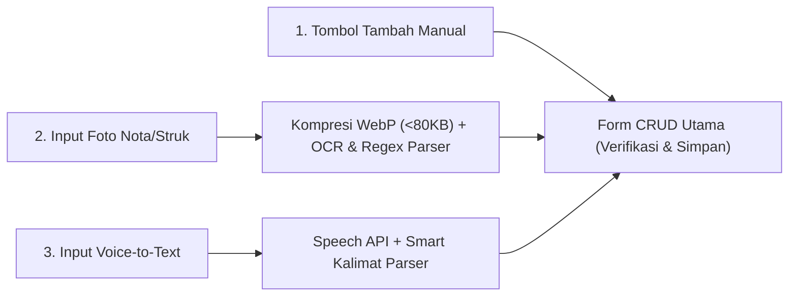

# Product Requirements Document (PRD)
## Aplikasi Pencatatan Keuangan Multi-Workspace (Pribadi, Usaha, Kopdes)

| Informasi Dokumen | Detail |
| :--- | :--- |
| **Versi Dokumen** | 1.0 (Draft Analisa) |
| **Tanggal** | 2 November 2026 |
| **Arsitektur Utama** | Offline-First PWA (Progressive Web App) |
| **Tech Stack Frontend** | Svelte 5 + Vite + Tailwind CSS + Dexie.js (IndexedDB) |
| **Target Backend (Bertahap)** | Fase 1: Offline Lokal $\rightarrow$ Fase 2: Supabase $\rightarrow$ Fase 3: Home Server (Go + SQLite/Postgres) |

---

## 1. Tujuan Produk (Product Vision)
Membangun aplikasi pencatatan keuangan yang **sangat ringan, aman, responsif (HP & Laptop), dan bekerja 100% offline secara default**, dengan kemampuan memisahkan secara tegas pencatatan uang **Pribadi**, **Usaha**, dan **Kerja (Manager Kopdes)** tanpa tercampur, namun tetap mendukung transaksi silang seperti **Dana Talangan / Reimburse**.

---

## 2. Prinsip Desain & Pengalaman Pengguna (Anti "AI Slop")
1. **Zero Fluff / Tanpa Basa-basi:** Tidak ada kalimat sapaan panjang, kutipan motivasi, atau sub-teks penjelas yang tidak perlu di bawah judul menu.
2. **Tipografi Angka Presisi:** Menggunakan font **Plus Jakarta Sans** dengan seluruh nominal wajib memakai `tabular-nums` (lebar angka sejajar) agar deretan ribuan dan jutaan lurus vertikal seperti laporan akuntansi.
3. **Dynamic Workspace Theme (Solid Flat Color — Tanpa Gradient):**
   - **Buku Pribadi (`personal`):** Solid Deep Indigo (`bg-indigo-950`)
   - **Buku Usaha (`business`):** Solid Deep Teal (`bg-teal-900`)
   - **Manager Kopdes (`kopdes`):** Solid Forest Emerald (`bg-emerald-900`)
   - Indikator fungsional: Hijau Tua (Pemasukan), Merah Tua (Pengeluaran), Biru (Transfer), Amber (Dana Talangan / Reimburse).
   - Ikon garis tipis (`16px–18px`) hanya digunakan sebagai penanda navigasi dan aksi, bukan hiasan.
4. **Adaptive Layout (Responsif Sesuai Perangkat):**
   - **Mobile View (< 768px & Layar Kecil iPhone SE):** Fokus pada kecepatan jempol. *Hero Balance Card* di atas, *Mini Wallet Cards* geser horizontal tanpa scrollbar kasar, daftar transaksi harian serta manajemen dompet dalam bentuk *Card View* proporsional, dan tombol aksi cepat di bawah.
   - **Desktop/Laptop View ($\ge$ 768px):** Tampilan *Spreadsheet/Table View* dengan filter multi-kolom, rekap cepat per kategori/unit, dan tombol Export laporan.

---

## 3. Ruang Kerja (Multi-Workspace Architecture)

Aplikasi memiliki **3 Buku Kas Utama (Workspace)** yang dapat diganti secara instan melalui *Segmented Switcher* di bagian atas layar:

### 3.1. Buku Pribadi (`personal`)
- Fokus: Kebutuhan rumah tangga, gaji/pendapatan pribadi, tabungan, investasi, dan pengeluaran harian.
- Contoh Akun/Dompet: Dompet Tunai, Bank Pribadi, E-Wallet.

### 3.2. Buku Usaha (`business`)
- Fokus: Arus kas usaha sampingan/pribadi, modal, HPP/pembelian bahan, omzet penjualan, biaya operasional usaha, serta piutang pelanggan.
- Contoh Akun/Dompet: Kas Tunai Usaha, Rekening Usaha.

### 3.3. Buku Kerja - Manager Kopdes (`kopdes`)
- Fokus: Pencatatan arus kas operasional dan manajerial Koperasi Desa yang berada di bawah tanggung jawab Manager.
- **Atribut Tambahan Khusus Buku Kopdes (Opsional/Fleksibel saat input):**
  - `unit_usaha`: Unit Simpan Pinjam (USP), Unit Toko/Ritel, Unit Pertanian/Pupuk, Jasa/Lainnya, atau Umum/Sekretariat.
  - `no_bukti`: Nomor Kwitansi / Nota / Bukti Kas Masuk (BKM) / Bukti Kas Keluar (BKK).
  - `pic_pihak`: Nama anggota, staf, atau suplier terkait.
- **Kategori Default Kopdes:**
  - *Pemasukan:* Setoran Unit Usaha, Simpanan Pokok/Wajib/Sukarela, Angsuran Masuk, Dana Hibah/Penyertaan, Lain-lain.
  - *Pengeluaran:* Belanja Barang Unit, Biaya Operasional Kantor (ATK/Listrik/Konsumsi), Honor/Gaji Pengurus & Staf, Pencairan Pinjaman, Perjalanan Dinas/Rapat, Lain-lain.

### 3.4. Fitur Lintas Buku: Dana Talangan & Reimburse (`reimbursement`)
Mengatasi kasus nyata ketika uang **Pribadi** dipakai menalangi pengeluaran **Kopdes** atau **Usaha** terlebih dahulu:
- Saat input pengeluaran di buku **Kopdes** atau **Usaha**, tersedia opsi **"Dibayar pakai Dana Talangan (Uang Pribadi)"**.
- Sistem otomatis:
  1. Mencatat pengeluaran pada buku **Kopdes/Usaha**.
  2. Mengurangi saldo dompet di buku **Pribadi**.
  3. Menandai transaksi tersebut dengan status `Belum Diganti (Pending Reimburse)`.
- Ketika uang diganti oleh bendahara/kas Kopdes, cukup klik **"Tandai Sudah Diganti"** $\rightarrow$ saldo kas Kopdes berkurang dan saldo dompet Pribadi kembali bertambah.

---

## 4. Spesifikasi 3 Sumber Input ke Form CRUD

Semua metode input bermuara ke **1 Komponen Form CRUD Utama** agar pengguna selalu memegang kendali penuh (verifikasi akhir) sebelum data disimpan ke database.

### 4.1. Sumber 1: Form CRUD Biasa (Quick Manual Entry)
- **Operasi CRUD Penuh:** Create, Read/Detail, Update (Edit transaksi), dan Soft-Delete.
- **Input Nominal & Kalkulator Responsif:**
  - Otomatis menampilkan keyboard angka di HP (`inputmode="decimal"`) dan memformat titik ribuan secara *real-time* saat mengetik.
  - Dilengkapi tombol pecahan cepat (`+10rb`, `+50rb`, `+100rb`, `.000`) dan tombol operator kalkulator (`+`, `−`, `×`, `÷`, `=`) dalam grid proporsional.
- **Field Form CRUD:**
  - `Workspace` (Otomatis sesuai tab aktif, bisa diubah).
  - `Tipe Transaksi`: Pemasukan | Pengeluaran | Transfer Antar Akun | Kasbon/Piutang | Utang Masuk.
  - `Nominal (Rp)` *(Wajib)*.
  - `Tanggal & Jam` *(Default: Sekarang)*.
  - `Dompet Kas` *(Compact Grid 2-3 kolom lengkap dengan info saldo)*.
  - `Kategori` *(Smart Quick Grid 4 kategori utama + Expandable Search Picker untuk memilih/mencari kategori lainnya tanpa membuat form memanjang)*.
  - `Catatan / Deskripsi Singkat`.
  - `Atribut Kopdes` *(Muncul khusus jika Workspace = Kopdes: Unit Usaha dalam Grid 2 kolom, No. Bukti, Pihak Terkait)*.
  - `Lampiran Foto Nota` *(Opsional, hasil kompresi)*.

### 4.2. Sumber 2: Input Foto Nota / Struk (Camera / Gallery $\rightarrow$ Form CRUD)
1. **Akuisisi & Optimasi Memori/Storage:**
   - Foto dari kamera/galeri langsung diproses di memori browser menggunakan `<canvas>`.
   - Diubah ukurannya ke maksimal lebar/tinggi `1000px`, mode *grayscale/high-contrast* opsional, dan dikompres ke format **WebP kualitas 0.6 (Ukuran akhir hanya ~40 KB – 80 KB)** sehingga ribuan struk tidak membuat penuh storage HP atau SSD 128 GB nantinya.
   - Opsi hemat ekstrem: Toggle *"Hanya ambil teks, jangan simpan gambar"*.
2. **Ekstraksi Teks (OCR) & Smart Parser:**
   - Mengekstrak teks dari gambar struk (mendukung mode offline via *TextDetector API* bawaan browser atau Tesseract WASM).
   - **Parser Otomatis & Tampilan Adaptif (List Produk vs Single Total):**
     - Memisahkan secara tegas baris metadata struk (`No. Nota`, `Waktu`, `Kasir`, `Jenis/Nama Order`) dari baris produk.
     - **Mode List Produk (Checklist Interaktif):** Jika struk memiliki rincian produk, menampilkan daftar produk dengan *checkbox* sehingga pengguna dapat memilih seluruh item (Grand Total) atau mencentang item tertentu saja (misal memisahkan belanjaan Kopdes/Usaha dari barang pribadi).
     - **Mode Single Total:** Jika nota/kwitansi hanya berisi 1 nilai total tanpa rincian produk, menampilkan kartu ringkasan total tunggal yang bersih.
     - Mencari kata kunci `TOTAL`, `GRAND TOTAL`, `TOTAL BAYAR`, `SUBTOTAL`, atau jumlah item terpilih $\rightarrow$ mengisi kolom **Nominal**.
     - Mencari pola tanggal (`DD/MM/YYYY`, `DD-MM-YYYY`, atau `DD MMM YY HH:mm`) $\rightarrow$ mengisi kolom **Tanggal**.
     - Mengambil nama toko/vendor beserta rangkuman produk terpilih $\rightarrow$ mengisi kolom **Catatan**, **No. Bukti**, **Pihak Terkait**, dan menyimpan rincian produk ke `metadata.items`.
3. **Verifikasi:** Membuka Form CRUD yang sudah terisi otomatis, menampilkan preview struk kecil di bawah, siap dikoreksi atau langsung klik **Simpan**.

### 4.3. Sumber 3: Voice-to-Text (Suara $\rightarrow$ Form CRUD)
1. **Akuisisi Suara:** Menggunakan `Web Speech API` (`SpeechRecognition` dengan bahasa `id-ID`).
2. **Natural Language Rule-Based Parser (Tanpa AI Berat):**
   - Mengubah kata bilangan bahasa Indonesia maupun angka menjadi nominal (contoh: *"seratus dua puluh lima ribu"* atau *"125 ribu"* $\rightarrow$ `125000`, *"dua setengah juta"* $\rightarrow$ `2500000`).
   - Mendeteksi kata kunci tipe transaksi:
     - Kata *"terima, masuk, jual, setoran, gajian"* $\rightarrow$ `Pemasukan`.
     - Kata *"beli, bayar, keluar, belanja, bensin, makan"* $\rightarrow$ `Pengeluaran`.
   - Mendeteksi kata kunci Workspace & Akun (contoh: ada kata *"koperasi / kopdes"* otomatis mengarahkan ke buku `Kopdes`).
   - Sisa kalimat bersih dimasukkan ke kolom **Catatan**.
3. **Verifikasi:** Langsung membuka Form CRUD dengan seluruh kolom terisi otomatis.

---

## 5. Arsitektur Data & Kesiapan Sinkronisasi (Offline $\rightarrow$ Supabase $\rightarrow$ Home Server)

Setiap entitas data di **Dexie.js (IndexedDB)** dirancang identik dengan skema **PostgreSQL / SQLite** agar migrasi berjalan mulus tanpa ubah struktur.

### 5.1. Skema Tabel Inti

#### A. Tabel `workspaces` (Buku Kas)
- `id` (UUID / String: `'personal'`, `'business'`, `'kopdes'`)
- `name` (String)
- `currency` (Default: `'IDR'`)

#### B. Tabel `accounts` (Dompet / Rekening Kas)
- `id` (UUID v7)
- `workspace_id` (`'personal'` | `'business'` | `'kopdes'`)
- `name` (Contoh: `'Kas Kecil Kopdes'`, `'BRI Kopdes'`, `'Dompet Pribadi'`)
- `type` (`'cash'` | `'bank'` | `'ewallet'`)
- `initial_balance` (Integer - disimpan dalam satuan Rupiah bulat tanpa pecahan desimal floating-point agar akurat)
- `updated_at`, `deleted_at`, `sync_status`

#### C. Tabel `categories` (Kategori)
- `id` (UUID v7)
- `workspace_id`
- `name` (Contoh: `'ATK & Fotokopi'`, `'Setoran Unit Toko'`)
- `type` (`'income'` | `'expense'`)
- `updated_at`, `deleted_at`, `sync_status`

#### D. Tabel `transactions` (Transaksi Utama)
- `id` (UUID v7)
- `workspace_id` (`'personal'` | `'business'` | `'kopdes'`)
- `account_id` (Relasi ke `accounts.id`)
- `to_account_id` (Nullable - untuk Transfer antar akun)
- `category_id` (Relasi ke `categories.id`)
- `type` (`'income'` | `'expense'` | `'transfer'` | `'debt'` | `'receivable'`)
- `amount` (BigInt / Integer positif)
- `date` (ISO 8601 Date String)
- `note` (String)
- `metadata` (JSON Object untuk data fleksibel):
  - `no_bukti`: String (Khusus Kopdes/Usaha)
  - `unit_usaha`: String (Khusus Kopdes)
  - `pic_pihak`: String (Nama anggota/vendor)
  - `items`: Array `[{ id, name, amount }]` (Opsional - Rincian produk dari ekstraksi struk)
  - `reimburse_status`: `'none'` | `'pending'` | `'settled'`
  - `reimburse_from_account_id`: UUID (Jika ditalangi dompet pribadi)
- `attachment_blob` (Blob WebP terkompresi / Nullable)
- `created_at`, `updated_at`, `deleted_at` (Soft Delete)
- `sync_status` (`'pending'` | `'synced'`)

---

## 6. Keamanan & Optimasi Resource

### 6.1. Keamanan (Mitigasi Celah Modern)
1. **100% Client-Side Static Build:** Tidak menggunakan SSR/Server Middleware yang rentan terhadap *Auth Bypass*.
2. **Minimal Dependency:** Format mata uang (`Rp`), tanggal, kalkulasi, dan parser suara dibuat dengan *native JavaScript APIs* (`Intl`, `WebCrypto`, `RegExp`) untuk mencegah *Supply-Chain Attack* dari package pihak ketiga.
3. **App PIN Lock & Enkripsi Lokal:**
   - Opsi mengunci aplikasi dengan PIN 6 digit.
   - Mendukung enkripsi backup file menggunakan **WebCrypto API (`AES-GCM 256-bit`)**.
4. **Strict CSP (Content Security Policy):** Mencegah injeksi script (XSS) dan membatasi koneksi keluar hanya ke URL Supabase / Home Server yang diizinkan pengguna.

### 6.2. Optimasi Memori & Storage (HP & Laptop Celeron 4GB)
1. **Virtual List / Pagination:** Menampilkan transaksi dengan *pagination* atau *virtual scrolling* sehingga meski ada 50.000 transaksi, RAM browser tetap di bawah `50 MB`.
2. **Kompresi Gambar Otomatis:** Setiap struk dipaksa turun ke `< 80 KB` (WebP). 1.000 foto struk hanya memakan `~80 MB` storage.
3. **Database Compaction:** Fitur pembersihan *soft-deleted records* dan ekspor arsip tahunan ke file lokal.

---

## 7. Roadmap Implementasi Bertahap

### Fase 1: Core Offline-First PWA (Fokus Saat Ini)
- [x] Setup project **Svelte 5 + Vite + Tailwind CSS** (berjalan 100% lokal di browser).
- [x] Implementasi database lokal **Dexie.js** dengan skema siap-sinkronisasi (`UUID v7`, `updated_at`, `deleted_at`, `sync_status`).
- [x] Pembuatan UI Multi-Workspace (`Pribadi`, `Usaha`, `Kopdes`) dengan tema warna solid per buku dan layout responsif (Mobile Card View & Desktop Table View).
- [x] Implementasi **Form CRUD Utama** + Kalkulator Nominal + Smart Picker Dompet/Kategori + Fitur Dana Talangan/Reimburse.
- [x] Implementasi **Smart Voice-to-Text Parser (Bahasa Indonesia)** $\rightarrow$ masuk ke Form CRUD.
- [x] Implementasi **Camera/Photo Compressor + OCR Struk Parser** $\rightarrow$ masuk ke Form CRUD.
- [ ] Fitur **Laporan, Filter Tanggal/Unit Kopdes, Export CSV/Excel, Backup/Restore JSON, PIN Lock, & PWA Offline Manifest**.

### Fase 2: Cloud Database Sync (Supabase)
- [ ] Menambahkan `SupabaseSyncAdapter`.
- [ ] Sinkronisasi latar belakang (*Background Sync*): Hanya mengirim baris dengan `sync_status = 'pending'` dan menarik perubahan terbaru berdasarkan `updated_at` (*Delta Sync* agar hemat kuota & baterai).
- [ ] Penerapan *Row Level Security (RLS)* di Supabase.

### Fase 3: Migrasi ke Home Server (Laptop Intel Celeron, RAM 4GB, SSD 128GB)
- [ ] Pembuatan Backend REST API super ringan dengan **Go (Golang)** + **SQLite (WAL Mode) / PostgreSQL**.
- [ ] Migrasi data 1-klik dari Supabase/Backup JSON ke Home Server.
- [ ] Mengarahkan URL Sync di pengaturan PWA ke IP/Domain Home Server (via Tailscale atau Cloudflare Tunnel).

